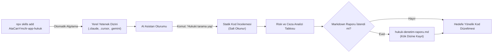

# tr-app-hukuk


**Yapay zeka kodlama asistanları için Türkiye mevzuatı ve KVKK denetim yeteneği.**

[](LICENSE)
[](https://github.com/AtaCanYmc/tr-app-hukuk/actions/workflows/ci.yml)
[](skills/tr-app-hukuk/SKILL.md)
[](ROADMAP.md)
[](#denetim-kapsamı-ve-cezai-üst-sınırlar)
[](CONTRIBUTING.md)

---

## Genel Bakış

`tr-app-hukuk`, Türkiye'de yayında olan ya da yayına girecek mobil ve web uygulamalarının kaynak kodlarını Türk tüketici, ticaret, telif, internet yayıncılığı ve kişisel verilerin korunması mevzuatına göre denetleyen açık kaynaklı bir yapay zeka sistem yeteneğidir.

Claude Code, Cursor, Google Antigravity, GitHub Copilot, Gemini CLI ve Windsurf ortamlarıyla tam uyumludur. Jenerik ve yüzeysel yapay zeka yanıtları yerine; projenin mimarisini tarar, dosya ve satır numaralarıyla kesin referanslar üretir ve 2026 yılı yasal ceza risklerini raporlar.

Harici paket yükleme zorunluluğu yoktur. Node.js standart kütüphanesini kullanır ve sıfır harici bağımlılıkla çalışır.

---

## İçindekiler

- [Genel Bakış](#genel-bakış)
- [Teknik Prensipler](#teknik-prensipler)
- [Kurulum](#kurulum)
  - [Ajan Uyumluluk Matrisi](#ajan-uyumluluk-matrisi)
  - [Yöntem 1: Skills CLI (Önerilen)](#yöntem-1-skills-cli-npx-skills-add---önerilen)
  - [Yöntem 2: Tek Satırlık POSIX Kabuk Kurucusu](#yöntem-2-tek-satırlık-posix-kabuk-kurucusu)
  - [Yöntem 3: Windows PowerShell Kurucusu](#yöntem-3-windows-powershell-kurucusu)
  - [Yöntem 4: Doğrudan Kurulum (npx github:)](#yöntem-4-doğrudan-kurulum-npx-github)
  - [Yöntem 5: Manuel Yapılandırma](#yöntem-5-manuel-yapılandırma)
  - [Yöntem 6: GitHub Actions Hibrit PR Botu](#yöntem-6-github-actions-hibrit-pr-botu)
- [Hızlı Başlangıç ve Kullanım Senaryoları](#hızlı-başlangıç-ve-kullanım-senaryoları)
- [Denetim Kapsamı ve Cezai Üst Sınırlar](#denetim-kapsamı-ve-cezai-üst-sınırlar)
- [Çalışma Mimarisi](#çalışma-mimarisi)
- [Depo Mimarisi](#depo-mimarisi)
- [Sıkça Sorulan Sorular](#sıkça-sorulan-sorular)
- [Yönetişim ve Belgeler](#yönetişim-ve-belgeler)
- [Lisans](#lisans)

---

## Teknik Prensipler

- **Sıfır Halüsinasyon ve Doğrulama**: Tahmin yürütmez. Kodda kesin olarak görülemeyen veya doğrulanamayan başlıklar için net olarak `Doğrulanamadı` veya `Bulunamadı` etiketi verir.
- **Kesin Satır Referansları**: Tüm bulguları `dosya_yolu:satır_numarası` formatında raporlar.
- **Salt Okunur Denetim Modu**: Kullanıcı açıkça onay verip talep etmediği sürece kaynak kod dosyalarında hiçbir değişiklik yapmaz.
- **2026 Mevzuat Kalibrasyonu**: Cezai üst sınırlar, Hazine ve Maliye Bakanlığı'nın 2026 yılı için açıkladığı yüzde 25,49 yeniden değerleme oranına göre hesaplanmış güncel tutarlardır.
- **İsteğe Bağlı Markdown Raporlama**: Tarama sonunda kullanıcıya sorar. Onay verilirse projenin kök dizininde yapısal bir `hukuk-denetim-raporu.md` dosyası üretir.

---

## Kurulum

`tr-app-hukuk`, Vercel Labs açık `skills` ekosistemi üzerinden ya da projenin dahili CLI aracıyla doğrudan GitHub üzerinden kurulabilir.

### Ajan Uyumluluk Matrisi

| Yapay Zeka Aracı | Global Yetenek Dizini | Çalışma Alanı (Proje) Yolu | Durum |
| :--- | :--- | :--- | :---: |
| **Claude Code** | `~/.claude/skills/` | `.claude/skills/tr-app-hukuk/` | Doğrulandı |
| **Cursor** | `~/.cursor/skills/` | `.cursor/skills/tr-app-hukuk/` | Doğrulandı |
| **Google Antigravity / Gemini CLI** | `~/.gemini/antigravity/skills/` | `.gemini/skills/tr-app-hukuk/` | Doğrulandı |
| **GitHub Copilot CLI / Codex** | `~/.codex/skills/` | `.github/skills/tr-app-hukuk/` | Doğrulandı |
| **Windsurf / Cascade** | `~/.windsurf/skills/` | `.windsurf/skills/tr-app-hukuk/` | Doğrulandı |

---

### Yöntem 1: Skills CLI (`npx skills add` - Önerilen)

Yapay zeka kodlama asistanları için standart paket yöneticisi olan `skills` CLI ile tek komutta kurun:

```bash
# Aktif proje çalışma alanına ekleyin
npx skills add AtaCanYmc/tr-app-hukuk

# Makinenizdeki tüm algılanan ajanlar için global kurun
npx skills add AtaCanYmc/tr-app-hukuk -g

# Etkileşimsiz olarak belirli ajanlara kurun
npx skills add AtaCanYmc/tr-app-hukuk --agent claude-code cursor antigravity -y
```

---

### Yöntem 2: Tek Satırlık POSIX Kabuk Kurucusu

macOS ve Linux ortamlarında doğrudan terminalden `curl` ile çalıştırılabilir:

```bash
# Otomatik tespit ile kurulu tüm ortamlara kurun
curl -fsSL https://raw.githubusercontent.com/AtaCanYmc/tr-app-hukuk/main/install.sh | sh

# Ya da belirli bir hedef ajan için kurun
curl -fsSL https://raw.githubusercontent.com/AtaCanYmc/tr-app-hukuk/main/install.sh | sh -s -- --claude
curl -fsSL https://raw.githubusercontent.com/AtaCanYmc/tr-app-hukuk/main/install.sh | sh -s -- --cursor
curl -fsSL https://raw.githubusercontent.com/AtaCanYmc/tr-app-hukuk/main/install.sh | sh -s -- --antigravity
curl -fsSL https://raw.githubusercontent.com/AtaCanYmc/tr-app-hukuk/main/install.sh | sh -s -- --copilot
curl -fsSL https://raw.githubusercontent.com/AtaCanYmc/tr-app-hukuk/main/install.sh | sh -s -- --windsurf
curl -fsSL https://raw.githubusercontent.com/AtaCanYmc/tr-app-hukuk/main/install.sh | sh -s -- --all
```

---

### Yöntem 3: Windows PowerShell Kurucusu

Windows PowerShell veya PowerShell Core üzerinde tek satırda çalıştırılabilir:

```powershell
# Otomatik tespit ile kurulu tüm ortamlara kurun
irm https://raw.githubusercontent.com/AtaCanYmc/tr-app-hukuk/main/install.ps1 | iex

# Ya da parametreli çalıştırma için indirip çalıştırın:
powershell -ExecutionPolicy Bypass -File .\install.ps1 -Claude
powershell -ExecutionPolicy Bypass -File .\install.ps1 -Cursor
powershell -ExecutionPolicy Bypass -File .\install.ps1 -Gemini
powershell -ExecutionPolicy Bypass -File .\install.ps1 -Copilot
powershell -ExecutionPolicy Bypass -File .\install.ps1 -Windsurf
powershell -ExecutionPolicy Bypass -File .\install.ps1 -All
```

---

### Yöntem 4: Doğrudan Kurulum (`npx github:`)

NPM kayıt defterine gerek kalmadan doğrudan bu deponun dahili kurulum betiğini çalıştırın:

```bash
# Claude Code için varsayılan kurulum
npx github:AtaCanYmc/tr-app-hukuk

# Ya da hedef ajan belirterek kurulum yapın
npx github:AtaCanYmc/tr-app-hukuk --target=cursor
npx github:AtaCanYmc/tr-app-hukuk --target=gemini
npx github:AtaCanYmc/tr-app-hukuk --target=copilot
npx github:AtaCanYmc/tr-app-hukuk --target=windsurf

# Tüm desteklenen ajanlar için aynı anda kurun
npx github:AtaCanYmc/tr-app-hukuk --target=all

# Simülasyon modu (dosya yazmadan kurulumu test edin)
npx github:AtaCanYmc/tr-app-hukuk --dry-run
npx github:AtaCanYmc/tr-app-hukuk --dry-run --target=all

# Yetenek talimatını doğrudan terminale veya panoya yazdırın
npx github:AtaCanYmc/tr-app-hukuk --print

# Headless statik denetim modu (CI pipeline veya yerel kontrol)
npx github:AtaCanYmc/tr-app-hukuk --check

# Makine tarafından okunabilir JSON formatında denetim raporu
npx github:AtaCanYmc/tr-app-hukuk --json
```

---

### Yöntem 5: Manuel Yapılandırma

#### 1. Claude Code

```bash
mkdir -p .claude/skills/tr-app-hukuk
git clone https://github.com/AtaCanYmc/tr-app-hukuk.git /tmp/tr-app-hukuk
cp -r /tmp/tr-app-hukuk/skills/tr-app-hukuk/* .claude/skills/tr-app-hukuk/
rm -rf /tmp/tr-app-hukuk
```

#### 2. Cursor

```bash
mkdir -p .cursor/skills/tr-app-hukuk
git clone https://github.com/AtaCanYmc/tr-app-hukuk.git /tmp/tr-app-hukuk
cp -r /tmp/tr-app-hukuk/skills/tr-app-hukuk/* .cursor/skills/tr-app-hukuk/
rm -rf /tmp/tr-app-hukuk
```

İsteğe bağlı olarak `.cursor/rules/tr-hukuk.mdc` adında bir kural dosyası oluşturup içeriğine `skills/tr-app-hukuk/SKILL.md` metnini ekleyerek her sohbette aktif tutabilirsiniz.

#### 3. GitHub Copilot

```bash
mkdir -p .github/skills/tr-app-hukuk
git clone https://github.com/AtaCanYmc/tr-app-hukuk.git /tmp/tr-app-hukuk
cp -r /tmp/tr-app-hukuk/skills/tr-app-hukuk/* .github/skills/tr-app-hukuk/
rm -rf /tmp/tr-app-hukuk
```

Copilot Chat üzerinde `@workspace .github/skills/tr-app-hukuk/SKILL.md kurallarına göre projemi hukuki olarak incele` ifadesiyle çalıştırabilirsiniz.

---

### Yöntem 6: GitHub Actions Hibrit PR Botu

Projenizin Pull Request'lerinde otomatik yasal uyumluluk denetimi ve PR yorumu almak için `.github/workflows/hukuk.yml` dosyanıza ekleyin:

```yaml
name: Hukuki Denetim

on:
  pull_request:
    branches: [main]

permissions:
  pull-requests: write
  contents: read

jobs:
  audit:
    runs-on: ubuntu-latest
    steps:
      - uses: actions/checkout@v4
      - uses: actions/setup-node@v4
        with:
          node-version: 20

      # Hibrit GitHub Action: Sıfır maliyetli statik filtre + Opsiyonel LLM analizi
      - uses: AtaCanYmc/tr-app-hukuk@main
        with:
          github-token: ${{ secrets.GITHUB_TOKEN }}
          # Opsiyonel derin hukuki analiz için (Gemini / Claude / OpenAI):
          gemini-api-key: ${{ secrets.GEMINI_API_KEY }}
          fail-on-risk: 'true'
```

Tüm model seçenekleri, yetkilendirme ayarları ve gelişmiş yapılandırmalar için [GitHub Action ve PR Botu Kılavuzu](docs/github-action.md) belgesini inceleyin.

---

## Hızlı Başlangıç ve Kullanım Senaryoları

Yeteneği kurduktan sonra yapay zeka asistanınızın sohbet ekranına aşağıdaki komutlardan birini verin:

### Senaryo 1: Genel Yasal Uyumluluk Taraması

> **Komut:** `"Projemi hukuki olarak tara"` veya `"Uygulamamı Türkiye yasalarına göre denetle"`

Asistan projenin platformunu, harici servislerini ve toplanan kullanıcı verilerini tespit eder. Yedi yasal başlık altında bulguları dosya ve satır referanslarıyla tablo halinde listeler.

### Senaryo 2: Veritabanı, Supabase RLS ve Gizli Anahtar Denetimi

> **Komut:** `"Veritabanı güvenliği, Supabase RLS politikaları ve sızdırılmış gizli anahtarlar için denetim yap"`

Supabase tablolarında Row Level Security (RLS) etkinliğini, güvenlik politikalarını ve istemciye sızan `service_role` gibi yetkili anahtarları tarar.

### Senaryo 3: Yurt Dışı Veri Çıkışı, Google Fonts ve CDN Taraması

> **Komut:** `"KVKK m.9 kapsamında yurt dışı sunuculara giden istekleri ve harici font CDN çağrılarını listele"`

Google Fonts (`fonts.googleapis.com`), harici CDN'ler ve analitik SDK'larını listeler. Fontların yerel sunucuya (`next/font`, `@fontsource/*` vb.) taşınması için self-host rehberi sunar.

### Senaryo 4: Ticari İleti, SMS ve İYS Onay Denetimi

> **Komut:** `"Pazarlama e-postası ve SMS gönderimlerinde İYS ve ticari ileti onaylarını kontrol et"`

E-posta ve SMS gönderim kodlarını inceler. İleti Yönetim Sistemi (İYS) sorgulamasının yapılıp yapılmadığını, ret hakkı (unsubscribe / SMS ret kodu) ve MERSİS/unvan bilgilerini denetler.

### Senaryo 5: Formlarda Aydınlatma ve Açık Rıza Ayrımı

> **Komut:** `"Kayıt, iletişim ve bülten formlarında KVKK aydınlatma linki ve açık rıza onaylarını incele"`

Formlarda Aydınlatma Metni linkinin varlığını ve açık rıza onayının aydınlatma metninden ayrı tutulup tutulmadığını (birleşik onay yasağı ve pre-ticked kontrolü) doğrular.

### Senaryo 6: Ödeme Ekranı, Ön Bilgilendirme ve Mesafeli Satış Sözleşmesi

> **Komut:** `"6502 sayılı Kanun kapsamında ödeme, Ön Bilgilendirme Formu ve Mesafeli Satış Sözleşmesi onaylarını denetle"`

Ödeme öncesinde Ön Bilgilendirme Formu ve Mesafeli Satış Sözleşmesi onay adımlarının zorunlu tutulup tutulmadığını, cayma hakkını ve otomatik yenileme şartlarını inceler.

### Senaryo 7: Rapor Dosyası Üretimi ve Düzeltme

Tarama bittiğinde asistan şu soruyu yöneltir:
> *"Bu denetim sonuçlarını projenize `hukuk-denetim-raporu.md` dosyası olarak kaydetmek ister misiniz?"*

Onay verdiğinizde rapor kök dizine yazılır. Ardından asistan düzeltmek istediğiniz maddeler için minimum kod diff'i üretir.

---

## Denetim Kapsamı ve Cezai Üst Sınırlar

Aşağıdaki cezai üst sınırlar, 2026 yılı için belirlenen yüzde 25,49 yeniden değerleme oranı esas alınarak hesaplanmıştır:

| No | Yasal Dayanak | Denetim Kapsamı | 2026 Yasal Üst Sınırı | İlgili Madde |
| --- | --- | --- | --- | --- |
| **1** | **6502 sayılı Kanun** | Ödeme ekranı, Ön Bilgilendirme Formu (ÖBF) ve Mesafeli Satış Sözleşmesi (MSS) onayı, otomatik yenileme ve cayma hakkı | **10.837.065 TL** *(Haksız ticari uygulama)*<br>**3.973 TL** *(İşlem başına)* | m.48, m.62, m.77/1-a, m.77/13 |
| **2** | **6563 sayılı Kanun & İYS** | Ticari e-posta ve SMS gönderimleri, İYS onay sorgulaması, ret hakkı (unsubscribe / RET kodu) ve gönderici kimliği | **42.930 TL** *(Ret imkânı yokluğu)*<br>**28.620 TL** *(Kimlik eksikliği)*<br>**14.309 TL** *(Onaysız ileti / İYS ihlali)* | m.6, m.8, m.12 |
| **3** | **5846 sayılı FSEK** | Kullanıcı içerik yüklemelerinde hak sahipleri için uyar-kaldır mekanizması | **365.000 TL** *(Adli para cezası veya hapis)* | m.71, Ek m.4 |
| **4** | **5651 sayılı Kanun** | Yer sağlayıcı künyesi, hukuka aykırı içerik şikayet kanalı ve trafik logları | **1.000.000 TL** *(Kanuni nominal tutar)* | m.5, m.6 |
| **5** | **6698 sayılı KVKK** | Kayıt, iletişim ve bülten formlarında Aydınlatma Metni linki ve açık rızanın aydınlatmadan ayrı tutulması | **1.709.200 TL** *(Aydınlatma yükümlülüğü)* | m.5, m.10, m.18/1-a |
| **6** | **6698 sayılı KVKK** | Yurt dışına veri aktarımı, Google Fonts ve harici CDN tespiti ile yerel barındırma (self-host) çözümleri | **17.092.242 TL** *(Yurt dışı aktarım ihlali)* | m.9, m.18/1-b |
| **7** | **6698 sayılı KVKK** | Veritabanı / Supabase RLS denetimi, istemciye sızan service_role anahtarları ve 72 saat içinde Kurul'a ihlal bildirimi hazırlığı | **17.092.242 TL** *(Veri güvenliği tedbirleri)* | m.12, m.12/5, m.18/1-b |

Detaylı kanun metinleri ve bent incelemeleri için [`skills/tr-app-hukuk/references`](skills/tr-app-hukuk/references) dizinine başvurabilirsiniz.

---

## Çalışma Mimarisi



---

## Depo Mimarisi

```text
tr-app-hukuk/
├── .github/
│   ├── ISSUE_TEMPLATE/
│   │   ├── bug_report.yml               # Yapılandırılmış hata bildirim formu
│   │   ├── config.yaml                  # Güvenlik ve tartışma yönlendirmeleri
│   │   └── feature_request.yml          # Özellik ve mevzuat öneri formu
│   ├── PULL_REQUEST_TEMPLATE/
│   │   └── pull_request_template.md     # PR doğrulama ve checklist şablonu
│   ├── workflows/
│   │   ├── ci.yml                       # Sürekli entegrasyon (Node test, lint, link kontrolü)
│   │   └── release.yml                  # Release Please ile otomatik sürümleme
│   ├── CODEOWNERS                       # Kod sahipliği ve PR inceleme yönlendirmesi
│   └── dependabot.yml                   # Haftalık bağımlılık ve GitHub Actions güncellemeleri
├── assets/
│   └── logo.svg                         # Vektörel açık/koyu tema uyumlu logo
├── docs/
│   └── github-action.md                 # GitHub Action ve PR botu entegrasyon kılavuzu
├── scripts/
│   └── pr-bot.js                        # GitHub Actions hibrit PR botu ve LLM entegrasyonu
├── skills/
│   └── tr-app-hukuk/
│       ├── references/
│       │   ├── ceza-limitleri-2026.md   # 2026 yılı yeniden değerleme cezai üst limitleri
│       │   ├── emsal-kararlar.md        # Yargıtay ve KVKK Kurulu emsal kararları
│       │   ├── kanun-maddeleri.md       # İlgili kanun maddeleri ve fıkra gerekçeleri
│       │   ├── rapor-semasi.json        # JSON formatında denetim raporu şeması
│       │   └── regex-desenleri.md       # Ödeme, SMS, İYS, form, Supabase ve CDN regex kütüphanesi
│       ├── README.md                    # Yetenek alt modül kılavuzu
│       └── SKILL.md                     # Asistanın yürüttüğü ana sistem talimatı
├── .editorconfig                        # Çapraz editör biçimlendirme kuralları
├── .gitattributes                       # Çapraz platform satır sonu ve arşiv yapılandırması
├── .gitignore                           # Git izleme dışı dosya tanımları
├── .markdownlint.json                   # Markdown biçimlendirme kuralları
├── .markdownlintignore                 # Markdownlint yok sayma kuralları
├── .release-please-manifest.json        # Release Please sürüm manifestosu
├── action.yml                           # GitHub Action tanımı (Hibrit PR Botu)
├── CHANGELOG.md                         # Sürüm değişiklik kayıtları
├── CODE_OF_CONDUCT.md                   # Katılımcı davranış kuralları
├── CONTRIBUTING.md                      # Katkı kılavuzu ve Conventional Commits standardı
├── LICENSE                              # MIT Lisansı
├── README.md                            # Ana depo dokümantasyonu
├── release-please-config.json           # Release Please çoklu dosya sürümleme yapılandırması
├── ROADMAP.md                           # Teknik geliştirme kilometre taşları
├── SECURITY.md                          # Güvenlik açığı bildirim politikası ve SLA
├── install.js                           # Sıfır bağımlılıklı taşınabilir kurulum CLI betiği
├── install.ps1                          # Windows PowerShell kurulum betiği (irm | iex uyumlu)
├── install.sh                           # Taşınabilir POSIX kabuk kurucusu (curl | sh uyumlu)
├── package.json                         # NPM paket tanımı ve ikili komut eşlemeleri
└── test.js                              # Dahili test paketi (çoklu hedef kurulum simülasyonu)
```

---

## Sıkça Sorulan Sorular

### Bu araç kaynak kodlarımı harici sunuculara veya telemetri sistemlerine gönderir mi?

Hayır. `tr-app-hukuk` tamamen yerel dosyalardan oluşan statik bir yapay zeka yeteneğidir. Çalıştırma sırasında harici ağ istekleri atmaz, telemetri toplamaz ve kodlarınızı üçüncü şahıslara iletmez. İnceleme tamamen kendi yerel yapay zeka asistanınızın oturumu içinde gerçekleşir.

### NPM Registry üzerinde yayınlanmadan GitHub üzerinden nasıl kuruluyor?

`npx skills add AtaCanYmc/tr-app-hukuk` komutu, Vercel Labs `skills` motoru üzerinden doğrudan GitHub deposunu çözümler. Ayrıca `npx github:AtaCanYmc/tr-app-hukuk` komutu, `npx`'in yerel GitHub protokol desteğini kullanarak deponun `install.js` betiğini çalıştırır.

### 2026 yılı ceza tutarları neye göre belirlendi?

Hazine ve Maliye Bakanlığı'nın Vergi Usul Kanunu Genel Tebliği ile 2026 yılı için ilan ettiği yüzde 25,49 yeniden değerleme oranı, kanunlardaki mevcut maktu ceza tutarlarına uygulanarak hesaplanmıştır.

### Yetenek birden fazla yapay zeka aracında aynı anda kullanılabilir mi?

Evet. `npx github:AtaCanYmc/tr-app-hukuk --target=all` komutunu çalıştırarak projenizde Claude Code, Cursor, Gemini, Copilot ve Windsurf için gerekli tüm yetenek dizinlerini tek hamlede oluşturabilirsiniz.

---

## Yönetişim ve Belgeler

- [GitHub Action ve PR Botu Kılavuzu](docs/github-action.md)
- [Katkı Kılavuzu (Contributing)](CONTRIBUTING.md)
- [Güvenlik Politikası (Security Policy)](SECURITY.md)
- [Teknik Yol Haritası (Roadmap)](ROADMAP.md)
- [Değişiklik Günlüğü (Changelog)](CHANGELOG.md)

---

## Lisans

Bu proje [MIT Lisansı](LICENSE) kapsamında açık kaynak olarak sunulmaktadır.
