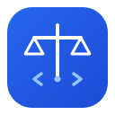
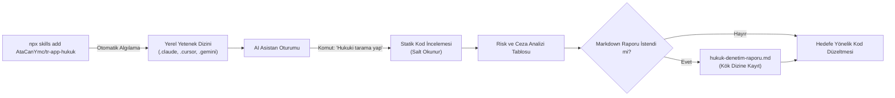

# tr-app-hukuk



**Yapay zeka kodlama asistanları için Türkiye mevzuatı ve KVKK denetim yeteneği.**

[](LICENSE)
[](.github/workflows/ci.yml)
[](skills/tr-app-hukuk/SKILL.md)
[](ROADMAP.md)
[](#denetim-kapsamı-ve-cezai-üst-sınırlar)
[](CONTRIBUTING.md)

---

## Genel Bakış

`tr-app-hukuk`, Türkiye'de yayında olan ya da yayına girecek mobil ve web uygulamalarının kaynak kodlarını Türk tüketici, ticaret, telif, internet yayıncılığı ve kişisel verilerin korunması mevzuatına göre denetleyen açık kaynaklı bir yapay zeka sistem yeteneğidir (AI agent skill).

Claude Code, Cursor, Google Antigravity, GitHub Copilot, Gemini CLI ve Windsurf ortamlarıyla tam uyumludur. Jenerik ve yüzeysel yapay zeka yanıtları yerine; projenin gerçek mimarisini tarar, dosya ve satır numaralarıyla kesin referanslar üretir ve 2026 yılı yasal ceza risklerini raporlar.

NPM yayını veya harici paket yükleme zorunluluğu yoktur. Node.js standart kütüphanesini kullanır ve sıfır harici bağımlılıkla çalışır.

---

## İçindekiler

- [Genel Bakış](#genel-bakış)
- [Teknik Prensipler](#teknik-prensipler)
- [Kurulum](#kurulum)
  - [Ajan Uyumluluk Matrisi](#ajan-uyumluluk-matrisi)
  - [Yöntem 1: Skills CLI (Önerilen)](#yöntem-1-skills-cli-npx-skills-add---önerilen)
  - [Yöntem 2: Tek Satırlık POSIX Kabuk Kurucusu](#yöntem-2-tek-satırlık-posix-kabuk-kurucusu)
  - [Yöntem 3: Doğrudan Kurulum (npx github:)](#yöntem-3-doğrudan-kurulum-npx-github)
  - [Yöntem 4: Manuel Yapılandırma](#yöntem-4-manuel-yapılandırma)
- [Hızlı Başlangıç ve Kullanım Senaryoları](#hızlı-başlangıç-ve-kullanım-senaryoları)
- [Denetim Kapsamı ve Cezai Üst Sınırlar](#denetim-kapsamı-ve-cezai-üst-sınırlar)
- [Çalışma Mimarisi](#çalışma-mimarisi)
- [Depo Mimarisi](#depo-mimarisi)
- [Sıkça Sorulan Sorular](#sıkça-sorulan-sorular)
- [Yönetişim ve Belgeler](#yönetişim-ve-belgeler)
- [Lisans](#lisans)

---

## Teknik Prensipler

- **Sıfır Halüsinasyon ve Doğrulama**: Tahmin yürütmez. Kodda kesin olarak görülemeyen veya doğrulanamayan başlıklar için net olarak `Doğrulanamadı` veya `Bulunamadı` etiketi verir.
- **Kesin Satır Referansları**: Tüm bulguları `dosya_yolu:satır_numarası` formatında raporlar.
- **Salt Okunur Denetim Modu**: Kullanıcı açıkça onay verip talep etmediği sürece kaynak kod dosyalarında hiçbir değişiklik yapmaz.
- **2026 Mevzuat Kalibrasyonu**: Cezai üst sınırlar, Hazine ve Maliye Bakanlığı'nın 2026 yılı için açıkladığı yüzde 25,49 yeniden değerleme oranına göre hesaplanmış güncel tutarlardır.
- **İsteğe Bağlı Markdown Raporlama**: Tarama sonunda kullanıcıya sorar; onay verilirse projenin kök dizininde yapısal bir `hukuk-denetim-raporu.md` dosyası üretir.

---

## Kurulum

`tr-app-hukuk`, Vercel Labs açık `skills` ekosistemi üzerinden ya da projenin dahili CLI aracıyla doğrudan GitHub üzerinden kurulabilir.

### Ajan Uyumluluk Matrisi

| Yapay Zeka Aracı | Global Yetenek Dizini | Çalışma Alanı (Proje) Yolu | Durum |
| :--- | :--- | :--- | :---: |
| **Claude Code** | `~/.claude/skills/` | `.claude/skills/tr-app-hukuk/` | Doğrulandı |
| **Cursor** | `~/.cursor/skills/` | `.cursor/skills/tr-app-hukuk/` | Doğrulandı |
| **Google Antigravity / Gemini CLI** | `~/.gemini/antigravity/skills/` | `.gemini/skills/tr-app-hukuk/` | Doğrulandı |
| **GitHub Copilot CLI / Codex** | `~/.codex/skills/` | `.github/skills/tr-app-hukuk/` | Doğrulandı |
| **Windsurf / Cascade** | `~/.windsurf/skills/` | `.windsurf/skills/tr-app-hukuk/` | Doğrulandı |

---

### Yöntem 1: Skills CLI (`npx skills add` - Önerilen)

Yapay zeka kodlama asistanları için standart paket yöneticisi olan `skills` CLI ile tek komutta kurun:

```bash
# Aktif proje çalışma alanına ekleyin
npx skills add AtaCanYmc/tr-app-hukuk

# Makinenizdeki tüm algılanan ajanlar için global kurun
npx skills add AtaCanYmc/tr-app-hukuk -g

# Etkileşimsiz olarak belirli ajanlara kurun
npx skills add AtaCanYmc/tr-app-hukuk --agent claude-code cursor antigravity -y
```

---

### Yöntem 2: Tek Satırlık POSIX Kabuk Kurucusu

Node.js kurulu olmadan, doğrudan terminalden `curl` ile çalıştırılabilir:

```bash
# Otomatik tespit ile kurulu tüm ortamlara kurun
curl -fsSL https://raw.githubusercontent.com/AtaCanYmc/tr-app-hukuk/main/install.sh | sh

# Ya da belirli bir hedef ajan için kurun
curl -fsSL https://raw.githubusercontent.com/AtaCanYmc/tr-app-hukuk/main/install.sh | sh -s -- --claude
curl -fsSL https://raw.githubusercontent.com/AtaCanYmc/tr-app-hukuk/main/install.sh | sh -s -- --cursor
curl -fsSL https://raw.githubusercontent.com/AtaCanYmc/tr-app-hukuk/main/install.sh | sh -s -- --antigravity
curl -fsSL https://raw.githubusercontent.com/AtaCanYmc/tr-app-hukuk/main/install.sh | sh -s -- --copilot
curl -fsSL https://raw.githubusercontent.com/AtaCanYmc/tr-app-hukuk/main/install.sh | sh -s -- --windsurf
curl -fsSL https://raw.githubusercontent.com/AtaCanYmc/tr-app-hukuk/main/install.sh | sh -s -- --all
```

---

### Yöntem 3: Doğrudan Kurulum (`npx github:`)

NPM kayıt defterine gerek kalmadan doğrudan bu deponun dahili kurulum betiğini çalıştırın:

```bash
# Claude Code için varsayılan kurulum
npx github:AtaCanYmc/tr-app-hukuk

# Ya da hedef ajan belirterek kurulum yapın
npx github:AtaCanYmc/tr-app-hukuk --target=cursor
npx github:AtaCanYmc/tr-app-hukuk --target=gemini
npx github:AtaCanYmc/tr-app-hukuk --target=copilot
npx github:AtaCanYmc/tr-app-hukuk --target=windsurf

# Tüm desteklenen ajanlar için aynı anda kurun
npx github:AtaCanYmc/tr-app-hukuk --target=all
```

---

### Yöntem 4: Manuel Yapılandırma

#### 1. Claude Code
```bash
mkdir -p .claude/skills/tr-app-hukuk
git clone https://github.com/AtaCanYmc/tr-app-hukuk.git /tmp/tr-app-hukuk
cp -r /tmp/tr-app-hukuk/skills/tr-app-hukuk/* .claude/skills/tr-app-hukuk/
rm -rf /tmp/tr-app-hukuk
```

#### 2. Cursor
```bash
mkdir -p .cursor/skills/tr-app-hukuk
git clone https://github.com/AtaCanYmc/tr-app-hukuk.git /tmp/tr-app-hukuk
cp -r /tmp/tr-app-hukuk/skills/tr-app-hukuk/* .cursor/skills/tr-app-hukuk/
rm -rf /tmp/tr-app-hukuk
```

Dilerseniz `.cursor/rules/tr-hukuk.mdc` adında bir kural dosyası oluşturup içeriğine `skills/tr-app-hukuk/SKILL.md` metnini ekleyerek her sohbette otomatik aktif tutabilirsiniz.

#### 3. GitHub Copilot
```bash
mkdir -p .github/skills/tr-app-hukuk
git clone https://github.com/AtaCanYmc/tr-app-hukuk.git /tmp/tr-app-hukuk
cp -r /tmp/tr-app-hukuk/skills/tr-app-hukuk/* .github/skills/tr-app-hukuk/
rm -rf /tmp/tr-app-hukuk
```

Copilot Chat üzerinde `@workspace .github/skills/tr-app-hukuk/SKILL.md kurallarına göre projemi hukuki olarak incele` ifadesiyle çalıştırabilirsiniz.

---

## Hızlı Başlangıç ve Kullanım Senaryoları

Yeteneği kurduktan sonra yapay zeka asistanınızın sohbet ekranına aşağıdaki komutlardan birini verin:

### Senaryo 1: Genel Yasal Uyumluluk Taraması

> **Komut:** `"Projemi hukuki olarak tara"` veya `"Uygulamamı Türkiye yasalarına göre denetle"`

Asistan projenin platformunu (iOS, Android, Web), harici servislerini (ödeme, e-posta, analitik, veritabanı) ve toplanan kullanıcı verilerini tespit eder. Altı başlık altında bulguları tablo halinde listeler.

### Senaryo 2: Yurt Dışı Veri Çıkışı ve KVKK Taraması

> **Komut:** `"KVKK m.9 ve m.12 kapsamında yurt dışı veri çıkışlarımı ve yazı tipi CDN isteklerimi incele"`

Harici Google Fonts, Sentry, Mixpanel, Firebase veya Datadog SDK çağrılarını inceler; kullanıcı IP adresi, telemetri veya form girdilerinin yurt dışı sunuculara aktarılıp aktarılmadığını tespit eder.

### Senaryo 3: Ödeme ve Abonelik Ekranı Denetimi

> **Komut:** `"6502 sayılı Kanun kapsamında ödeme ve abonelik iptal akışlarımı denetle"`

Abonelik iptal mekanizmalarını, yenileme periyotlarını, deneme sürümü sonu otomatik çekim şartlarını ve onay adımlarını kontrol eder.

### Senaryo 4: Rapor Dosyası Üretimi ve Düzeltme

Tarama bittiğinde asistan şu soruyu yöneltir:
> *"Bu denetim sonuçlarını projenize `hukuk-denetim-raporu.md` dosyası olarak kaydetmek ister misiniz?"*

Onay verdiğinizde rapor kök dizine yazılır. Ardından asistan düzeltmek istediğiniz maddeler için minimum kod diff'i üretir.

---

## Denetim Kapsamı ve Cezai Üst Sınırlar

Aşağıdaki cezai üst sınırlar, 2026 yılı için belirlenen yüzde 25,49 yeniden değerleme oranı esas alınarak hesaplanmıştır:

| No | Yasal Dayanak | Denetim Kapsamı | 2026 Yasal Üst Sınırı | İlgili Madde |
|---|---|---|---|---|
| **1** | **6502 sayılı Kanun** | Ödeme ekranı, abonelik yenileme periyodu, cayma hakkı ve gizli yenileme şartları | **10.837.065 TL** *(Haksız ticari uygulama)*<br>**3.973 TL** *(İşlem başına)* | m.62, m.77/1-a, m.77/13 |
| **2** | **6563 sayılı Kanun** | Ticari iletilerde gönderen kimliği, ret hakkı bağlantısı ve onaysız gönderimler | **42.930 TL** *(Ret linki yokluğu)*<br>**28.620 TL** *(Kimlik eksikliği)* | m.12 |
| **3** | **5846 sayılı FSEK** | Kullanıcı içerik yüklemelerinde hak sahipleri için uyar-kaldır mekanizması | **365.000 TL** *(Adli para cezası veya hapis)* | m.71 |
| **4** | **5651 sayılı Kanun** | Yer sağlayıcı künyesi, hukuka aykırı içerik şikayet kanalı ve trafik logları | **1.000.000 TL** *(Kanuni nominal tutar)* | m.5, m.6 |
| **5** | **6698 sayılı KVKK** | Toplanan verilerin amacı, saklama süresi ve aydınlatma metninin ilk temastan önce sunulması | **1.709.200 TL** *(Aydınlatma yükümlülüğü)* | m.10, m.18/1-a |
| **6** | **6698 sayılı KVKK** | Yurt dışına veri aktarımı (CDN, fonts, analitik) ve veri güvenliği ihlalleri | **17.092.242 TL** *(Kurul tavan uygulaması)* | m.9, m.12, m.18/1-b |

Detaylı kanun metinleri ve bent incelemeleri için [`skills/tr-app-hukuk/references`](skills/tr-app-hukuk/references) dizinine başvurabilirsiniz.

---

## Çalışma Mimarisi



---

## Depo Mimarisi

```text
tr-app-hukuk/
├── .github/
│   ├── dependabot.yml               # Haftalık otomatik bağımlılık ve eylem güncellemeleri
│   └── workflows/
│       ├── ci.yml                   # Sürekli entegrasyon (Node 18, 20, 22 test matrisi)
│       └── release.yml              # Release Please ile otomatik sürüm ve changelog
├── assets/
│   └── logo.svg                     # Vektörel açık/koyu tema uyumlu logo
├── skills/
│   └── tr-app-hukuk/
│       ├── references/
│       │   ├── ceza-limitleri-2026.md   # 2026 yılı yeniden değerleme cezai üst limitleri
│       │   └── kanun-maddeleri.md       # İlgili kanun maddeleri ve fıkra gerekçeleri
│       ├── README.md                # Yeteneğe özel alt klasör kılavuzu
│       └── SKILL.md                 # Asistanın yürüttüğü ana sistem talimatı
├── CHANGELOG.md                     # Sürüm değişiklik kayıtları
├── CODE_OF_CONDUCT.md               # Katılımcı davranış kuralları
├── CONTRIBUTING.md                  # Katkı kılavuzu ve Conventional Commits standardı
├── LICENSE                          # MIT Lisansı
├── README.md                        # Ana depo dokümantasyonu
├── ROADMAP.md                       # Teknik geliştirme kilometre taşları
├── SECURITY.md                      # Güvenlik açığı bildirim politikası ve SLA
├── install.js                       # Sıfır bağımlılıklı taşınabilir kurulum CLI betiği
├── install.sh                       # Taşınabilir POSIX kabuk kurucusu (curl | sh uyumlu)
├── package.json                     # NPM paket tanımı ve ikili komut eşlemeleri
└── test.js                          # Dahili test paketi (çoklu hedef kurulum simülasyonu)
```

---

## Sıkça Sorulan Sorular

#### Bu araç kaynak kodlarımı harici sunuculara veya telemetri sistemlerine gönderir mi?
Hayır. `tr-app-hukuk` tamamen yerel dosyalardan oluşan statik bir yapay zeka yeteneğidir. Çalıştırma sırasında harici ağ istekleri atmaz, telemetri toplamaz ve kodlarınızı üçüncü şahıslara iletmez. İnceleme tamamen kendi yerel yapay zeka asistanınızın oturumu içinde gerçekleşir.

#### NPM Registry üzerinde yayınlanmadan GitHub üzerinden nasıl kuruluyor?
`npx skills add AtaCanYmc/tr-app-hukuk` komutu, Vercel Labs `skills` motoru üzerinden doğrudan GitHub deposunu çözümler. Ayrıca `npx github:AtaCanYmc/tr-app-hukuk` komutu, `npx`'in yerel GitHub protokol desteğini kullanarak deponun `install.js` betiğini çalıştırır.

#### 2026 yılı ceza tutarları neye göre belirlendi?
Hazine ve Maliye Bakanlığı'nın Vergi Usul Kanunu Genel Tebliği ile 2026 yılı için ilan ettiği yüzde 25,49 yeniden değerleme oranı, kanunlardaki mevcut maktu ceza tutarlarına uygulanarak hesaplanmıştır.

#### Yetenek birden fazla yapay zeka aracında aynı anda kullanılabilir mi?
Evet. `npx github:AtaCanYmc/tr-app-hukuk --target=all` komutunu çalıştırarak projenizde Claude Code, Cursor, Gemini, Copilot ve Windsurf için gerekli tüm yetenek dizinlerini tek hamlede oluşturabilirsiniz.

---

## Yönetişim ve Belgeler

- [Katkı Kılavuzu (Contributing)](CONTRIBUTING.md)
- [Güvenlik Politikası (Security Policy)](SECURITY.md)
- [Teknik Yol Haritası (Roadmap)](ROADMAP.md)
- [Değişiklik Günlüğü (Changelog)](CHANGELOG.md)

---

## Lisans

Bu proje [MIT Lisansı](LICENSE) kapsamında açık kaynak olarak sunulmaktadır.
