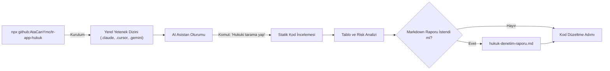

<p align="center">
  
</p>

<h1 align="center">tr-app-hukuk</h1>

<p align="center">
  Türkiye mevzuatı ve KVKK uyumluluğu için sıfır bağımlılıklı AI denetim yeteneği.
</p>

<p align="center">
  <a href="https://github.com/AtaCanYmc/tr-app-hukuk/actions/workflows/ci.yml"></a>
  <a href="https://github.com/AtaCanYmc/tr-app-hukuk/releases"></a>
  
  <a href="./LICENSE"></a>
</p>

---

## İçindekiler

- [Genel Bakış](#genel-bakış)
- [Hızlı Başlangıç](#hızlı-başlangıç)
- [Desteklenen Yapay Zeka Araçları](#desteklenen-yapay-zeka-araçları)
- [Çalışma Mimarisi](#çalışma-mimarisi)
- [Denetim Kapsamı ve Cezai Sınırlar](#denetim-kapsamı-ve-cezai-sınırlar)
- [Depo Mimarisi](#depo-mimarisi)
- [Sıkça Sorulan Sorular](#sıkça-sorulan-sorular)
- [Geliştirme ve Test](#geliştirme-ve-test)
- [Lisans](#lisans)

---

## Genel Bakış

`tr-app-hukuk`, Türkiye'de yayında olan veya yayına girecek mobil ve web uygulamalarının kaynak kodlarını Türk tüketici, ticaret, telif ve kişisel veri mevzuatına göre denetleyen bir AI sistem yeteneğidir.

NPM yayını gerektirmez; doğrudan GitHub reposu üzerinden `npx` ile çalıştırılabilir. Harici bağımlılık barındırmaz. Node.js standart kütüphanesi üzerinde çalışır; Claude Code, Cursor, Gemini, GitHub Copilot ve Windsurf ortamlarına saniyeler içinde kurulur.

## Hızlı Başlangıç

Hedef projenizin kök dizininde aşağıdaki yöntemlerden biriyle tek komutta kurun:

### Yöntem 1: Skills CLI ile Kurulum (Önerilen)
Vercel Labs açık yapay zeka yetenek ekosistemi üzerinden doğrudan kurabilirsiniz:

```bash
npx skills add AtaCanYmc/tr-app-hukuk
```

Bu komut projenizdeki aktif yapay zeka asistanını (Claude Code, Cursor, Copilot, Gemini, Windsurf vb.) otomatik tespit eder ve yeteneği bağlar.

### Yöntem 2: Standart GitHub CLI ile Kurulum
Ek bir paket yüklemeden doğrudan deponun yerel kurucusunu çalıştırabilirsiniz:

```bash
# Claude Code için varsayılan kurulum
npx github:AtaCanYmc/tr-app-hukuk

# Ya da hedef belirterek kurulum
npx github:AtaCanYmc/tr-app-hukuk --target=cursor
```

Kurulumun ardından asistanınıza şu komutu verin:

```text
"Projemi hukuki olarak tara"
```

Asistan projeyi statik olarak inceler, dosya ve satır referanslarıyla risk tablosu çıkarır. Tarama sonunda onay verirseniz sonuçları `hukuk-denetim-raporu.md` dosyasına kaydeder.

---

## Desteklenen Yapay Zeka Araçları

`npx skills add AtaCanYmc/tr-app-hukuk` komutu ortamdaki asistanı otomatik tespit eder. Alternatif olarak deponun dahili kurucusuyla hedefe özel kurulum yapabilirsiniz:

| Yapay Zeka Aracı | Standart Kurulum (`skills`) | Doğrudan Kurulum (`npx github:`) | Oluşturulan Dizin |
|---|---|---|---|
| **Claude Code** | `npx skills add AtaCanYmc/tr-app-hukuk` | `npx github:AtaCanYmc/tr-app-hukuk` | `.claude/skills/tr-app-hukuk/` |
| **Cursor** | `npx skills add AtaCanYmc/tr-app-hukuk` | `npx github:AtaCanYmc/tr-app-hukuk --target=cursor` | `.cursor/skills/tr-app-hukuk/` |
| **Gemini Code Assist** | `npx skills add AtaCanYmc/tr-app-hukuk` | `npx github:AtaCanYmc/tr-app-hukuk --target=gemini` | `.gemini/skills/tr-app-hukuk/` |
| **GitHub Copilot** | `npx skills add AtaCanYmc/tr-app-hukuk` | `npx github:AtaCanYmc/tr-app-hukuk --target=copilot` | `.github/skills/tr-app-hukuk/` |
| **Windsurf / Cascade** | `npx skills add AtaCanYmc/tr-app-hukuk` | `npx github:AtaCanYmc/tr-app-hukuk --target=windsurf` | `.windsurf/skills/tr-app-hukuk/` |
| **Tüm Araçlar (Toplu)** | — | `npx github:AtaCanYmc/tr-app-hukuk --target=all` | Yukarıdaki tüm dizinler |

### Araca Özel Kullanım Detayları

#### 1. Claude Code
Kurulumdan sonra Claude Code doğrudan `.claude/skills/` altındaki tanımları tanır. Terminalde `claude` oturumu açıp *"Projemi hukuki olarak tara"* demeniz yeterlidir.

#### 2. Cursor
`.cursor/skills/tr-app-hukuk/` altına kurulan kuralları Composer veya Chat üzerinde doğrudan çağırabilirsiniz. Dilerseniz `.cursor/rules/tr-hukuk.mdc` adında bir kural dosyası oluşturup içeriğine `skills/tr-app-hukuk/SKILL.md` metnini ekleyerek her zaman aktif tutabilirsiniz.

#### 3. GitHub Copilot
Projeye eklenen `.github/skills/tr-app-hukuk/` yapısını Copilot Chat içinde `@workspace` komutuyla birlikte kullanabilirsiniz:
```text
@workspace .github/skills/tr-app-hukuk/SKILL.md dosyasındaki kurallara göre projemi hukuki olarak denetle.
```
Alternatif olarak `.github/copilot-instructions.md` dosyanıza `SKILL.md` özetini ekleyebilirsiniz.

#### 4. Windsurf (Cascade)
Windsurf ortamında Cascade sohbetine şu komutu verebilirsiniz:
```text
.windsurf/skills/tr-app-hukuk/SKILL.md kılavuzunu oku ve projeyi Türkiye yasalarına göre denetle.
```

#### 5. Aider / CLI Araçları
Aider oturumunu başlatırken kural dosyasını referans verin:
```bash
aider --read .claude/skills/tr-app-hukuk/SKILL.md
```

---

## Çalışma Mimarisi



---

## Denetim Kapsamı ve Cezai Sınırlar

Aşağıdaki cezai üst sınırlar, Hazine ve Maliye Bakanlığı'nın 2026 yılı için belirlediği yüzde 25,49 yeniden değerleme oranı esas alınarak hesaplanmıştır.

| No | Yasal Dayanak | Denetim Kapsamı | 2026 Üst Sınır |
|---|---|---|---|
| 1 | 6502 sayılı Kanun | Ödeme adımı, abonelik yenileme şeffaflığı, cayma hakkı ve gizli yenileme şartları | 10.837.065 TL *(m.77/13)* |
| 2 | 6563 sayılı Kanun | Ticari e-postalarda gönderen unvanı, ret hakkı linki ve onaysız gönderimler | 42.930 TL *(ret linki yokluğu)* |
| 3 | 5846 sayılı FSEK | Kullanıcı içerik yüklemelerinde hak sahipleri için uyar-kaldır mekanizması | 365.000 TL *(adli para cezası / hapis)* |
| 4 | 5651 sayılı Kanun | Yer sağlayıcı künyesi, hukuka aykırı içerik şikayet kanalı, erişim logları | 1.000.000 TL *(kanuni nominal tutar)* |
| 5 | 6698 sayılı KVKK m.10 | Toplanan verilerin amacı, saklama süresi ve aydınlatma metninin ilk temastan önce sunulması | 1.709.200 TL *(m.18/1-a)* |
| 6 | 6698 sayılı KVKK m.9/12 | Yurt dışı sunuculara veri aktarımı (CDN, fonts, analitik, logger) ve veri güvenliği | 17.092.242 TL *(Kurul tavan uygulaması)* |

Detaylı kanun maddeleri ve gerekçeleri için [`skills/tr-app-hukuk/references/`](skills/tr-app-hukuk/references/) dizinini inceleyebilirsiniz.

---

## Depo Mimarisi

```text
tr-app-hukuk/
├── .github/
│   ├── dependabot.yml
│   └── workflows/
│       ├── ci.yml
│       └── release.yml
├── assets/
│   └── logo.svg
├── skills/
│   └── tr-app-hukuk/
│       ├── references/
│       │   ├── ceza-limitleri-2026.md
│       │   └── kanun-maddeleri.md
│       ├── README.md
│       └── SKILL.md
├── CHANGELOG.md
├── CODE_OF_CONDUCT.md
├── CONTRIBUTING.md
├── LICENSE
├── README.md
├── ROADMAP.md
├── install.js
├── package.json
└── test.js
```

---

## Sıkça Sorulan Sorular

### NPM kaydı olmadan GitHub üzerinden nasıl çalışıyor?
`npx`, `github:kullanici/repo` söz dizimini yerel olarak destekler. `npx github:AtaCanYmc/tr-app-hukuk` komutunu verdiğinizde NPM Registry'e gerek kalmadan GitHub'daki en güncel sürüm anında indirilir ve çalıştırılır.

### Bu araç kaynak kodlarımı harici sunuculara gönderir mi?
Hayır. Komut yalnızca projenize yerel markdown şablonlarını kopyalar. Kod analizi tamamen sizin yerel yapay zeka oturumunuz içinde gerçekleşir. Harici bir telemetri veya veri toplama mekanizması bulunmaz.

### Projede harici npm bağımlılığı var mı?
Hayır. Paket tamamen Node.js standart kütüphanesi (`node:fs`, `node:path`) ile çalışır. Bu sayede indirme süresi saniyeler sürer ve bağımlılık kaynaklı güvenlik riskleri oluşmaz.

### Birden fazla asistanı aynı anda kullanabilir miyim?
Evet. `npx github:AtaCanYmc/tr-app-hukuk --target=all` komutunu çalıştırarak tüm desteklenen asistanlar için gerekli dizinleri aynı anda oluşturabilirsiniz.

---

## Geliştirme ve Test

Projeyi klonladıktan sonra yerel test paketini çalıştırmak için:

```bash
git clone https://github.com/AtaCanYmc/tr-app-hukuk.git
cd tr-app-hukuk
npm test
```

Test paketi geçici bir dizinde tüm hedef dizin varyasyonlarını (`claude`, `cursor`, `gemini`, `copilot`, `windsurf`) doğrular.

---

## Lisans

Bu proje [MIT Lisansı](./LICENSE) kapsamında sunulmaktadır.
