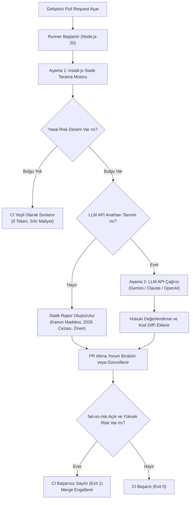

[← Ana Depoya Dön](../README.md)

# GitHub Action ve PR Denetim Botu

Bu doküman, `tr-app-hukuk` GitHub Action bileşeninin mimarisini, yapılandırma parametrelerini ve sürekli entegrasyon (CI/CD) iş akışlarına entegrasyonunu açıklar.

---

## İçindekiler

- [Genel Bakış](#genel-bakış)
- [Çalışma Mimarisi](#çalışma-mimarisi)
- [Yapılandırma ve Kullanım Senaryoları](#yapılandırma-ve-kullanım-senaryoları)
  - [1. Statik Mod (API Anahtarsız ve Ücretsiz)](#1-statik-mod-api-anahtarsız-ve-ücretsiz)
  - [2. Google Gemini Hibrit Modu (Önerilen)](#2-google-gemini-hibrit-modu-önerilen)
  - [3. Anthropic Claude Hibrit Modu](#3-anthropic-claude-hibrit-modu)
  - [4. OpenAI GPT Modu](#4-openai-gpt-modu)
- [Girdi Parametreleri Referansı](#girdi-parametreleri-referansı)
- [Gerekli Token ve Yetkilendirme Kuralları](#gerekli-token-ve-yetkilendirme-kuralları)
- [Yorum Yaşam Döngüsü ve Mükerrer Yorum Koruması](#yorum-yaşam-döngüsü-ve-mükerrer-yorum-koruması)
- [Merge Engelleme Politikası (fail-on-risk)](#merge-engelleme-politikası-fail-on-risk)

---

## Genel Bakış

`tr-app-hukuk` GitHub Action, yazılım projelerinde açılan Pull Request (PR) kodlarını Türk tüketici, ticaret ve kişisel verilerin korunması mevzuatına göre otomatik denetleyen hibrit bir CI botudur.

İki aşamalı bir mimariyle çalışır:

1. **Statik Filtre:** Değişen dosyalarda regex tabanlı yasal risk kalıplarını sıfır harici bağımlılıkla tarar. Risk yoksa LLM çağırmadan 1 saniyede sonlanır.
2. **Derin LLM Analizi:** Riskli kod tespit edildiğinde ve API anahtarı sağlandığında, ilgili kod parçasını ve kanun maddesini LLM'e ileterek somut hukuki değerlendirme ve kod düzeltme önerisi üretir.

---

## Çalışma Mimarisi



---

## Yapılandırma ve Kullanım Senaryoları

Projenizin `.github/workflows/hukuk.yml` dosyasına aşağıdaki şablonlardan birini ekleyebilirsiniz:

### 1. Statik Mod (API Anahtarsız ve Ücretsiz)

Harici hiçbir LLM API anahtarı gerektirmez. Sadece deterministik regex kuralları ve yasal ceza sınırlarıyla çalışır:

```yaml
name: Hukuki Denetim

on:
  pull_request:
    branches: [main]

permissions:
  pull-requests: write
  contents: read

jobs:
  audit:
    runs-on: ubuntu-latest
    steps:
      - uses: actions/checkout@v4
      - uses: actions/setup-node@v4
        with:
          node-version: 20

      - uses: AtaCanYmc/tr-app-hukuk@main
        with:
          github-token: ${{ secrets.GITHUB_TOKEN }}
          fail-on-risk: 'true'
```

---

### 2. Google Gemini Hibrit Modu (Önerilen)

Google Gemini'ın ücretsiz kullanım katmanı sayesinde ek maliyet oluşturmadan derin hukuki analiz sunar:

```yaml
name: Hukuki Denetim (Gemini)

on:
  pull_request:
    branches: [main]

permissions:
  pull-requests: write
  contents: read

jobs:
  audit:
    runs-on: ubuntu-latest
    steps:
      - uses: actions/checkout@v4
      - uses: actions/setup-node@v4
        with:
          node-version: 20

      - uses: AtaCanYmc/tr-app-hukuk@main
        with:
          github-token: ${{ secrets.GITHUB_TOKEN }}
          gemini-api-key: ${{ secrets.GEMINI_API_KEY }}
          model: 'gemini-2.5-flash'
          fail-on-risk: 'true'
```

---

### 3. Anthropic Claude Hibrit Modu

Anthropic Claude API anahtarı kullanarak analizi Claude 3.5 Haiku üzerinden yürütür:

```yaml
name: Hukuki Denetim (Claude)

on:
  pull_request:
    branches: [main]

permissions:
  pull-requests: write
  contents: read

jobs:
  audit:
    runs-on: ubuntu-latest
    steps:
      - uses: actions/checkout@v4
      - uses: actions/setup-node@v4
        with:
          node-version: 20

      - uses: AtaCanYmc/tr-app-hukuk@main
        with:
          github-token: ${{ secrets.GITHUB_TOKEN }}
          anthropic-api-key: ${{ secrets.ANTHROPIC_API_KEY }}
          model: 'claude-3-5-haiku-20241022'
          fail-on-risk: 'true'
```

---

### 4. OpenAI GPT Modu

OpenAI API anahtarı kullanarak analizi GPT-4o-mini üzerinden yürütür:

```yaml
name: Hukuki Denetim (OpenAI)

on:
  pull_request:
    branches: [main]

permissions:
  pull-requests: write
  contents: read

jobs:
  audit:
    runs-on: ubuntu-latest
    steps:
      - uses: actions/checkout@v4
      - uses: actions/setup-node@v4
        with:
          node-version: 20

      - uses: AtaCanYmc/tr-app-hukuk@main
        with:
          github-token: ${{ secrets.GITHUB_TOKEN }}
          openai-api-key: ${{ secrets.OPENAI_API_KEY }}
          model: 'gpt-4o-mini'
          fail-on-risk: 'true'
```

---

## Girdi Parametreleri Referansı

`action.yml` tarafından kabul edilen tüm girdi parametreleri:

| Parametre | Tip | Zorunlu mu? | Varsayılan Değer | Açıklama |
| :--- | :--- | :---: | :--- | :--- |
| `github-token` | String | Hayır | `${{ github.token }}` | PR altına yorum yazabilmek için gereken GitHub kimlik belirteci. |
| `gemini-api-key` | String | Hayır | `""` | Google Gemini API anahtarı. Tanımlanırsa Gemini üzerinden derin analiz yapar. |
| `anthropic-api-key` | String | Hayır | `""` | Anthropic Claude API anahtarı. Tanımlanırsa Claude üzerinden derin analiz yapar. |
| `openai-api-key` | String | Hayır | `""` | OpenAI API anahtarı. Tanımlanırsa GPT modelleri üzerinden derin analiz yapar. |
| `model` | String | Hayır | `gemini-2.5-flash` | Kullanılacak model adı (`gemini-2.5-flash`, `claude-3-5-haiku-20241022`, `gpt-4o-mini`). |
| `fail-on-risk` | Boolean / String | Hayır | `'true'` | Yüksek riskli bulgu tespit edildiğinde CI kontrolünü hata kodu (`exit 1`) ile sonlandırır. |
| `pr-comment` | Boolean / String | Hayır | `'true'` | PR altına detaylı hukuki analiz tablosu ve önerileri yorum olarak yazar. |

---

## Gerekli Token ve Yetkilendirme Kuralları

Botun PR altına yorum yazabilmesi ve kaynak kodları okuyabilmesi için iş akışında aşağıdaki izinlerin verilmesi zorunludur:

```yaml
permissions:
  pull-requests: write
  contents: read
```

---

## Yorum Yaşam Döngüsü ve Mükerrer Yorum Koruması

Bot, PR altına gönderdiği her rapora gizli bir tanımlayıcı ekler (`<!-- tr-app-hukuk-pr-comment -->`).

Geliştirici PR'a yeni bir commit gönderdiğinde:

- Bot yeni bir yorum açmaz.
- GitHub API üzerinden PR'daki eski raporunu tespit eder.
- Eski yorumun içeriğini güncel denetim sonuçlarıyla yerinde günceller (`PATCH`).
- Bu sayede PR tartışma akışında bildirim kirliliği oluşmaz.

---

## Merge Engelleme Politikası (fail-on-risk)

- `fail-on-risk: 'true'` (varsayılan): Yüksek risk sınıfında bir yasal ihlal (örneğin açık `service_role` anahtarı, eksik Ön Bilgilendirme Formu veya ret bağlantısız ticari SMS) tespit edildiğinde bot CI sürecini durdurur (`exit 1`).
- GitHub depo ayarlarında `Settings > Branches > Require status checks to pass before merging` kuralı etkinleştirilerek, hukuki riski temizlenmemiş kodların `main` branch'e ve canlı sunucuya geçmesi kesin olarak engellenir.
